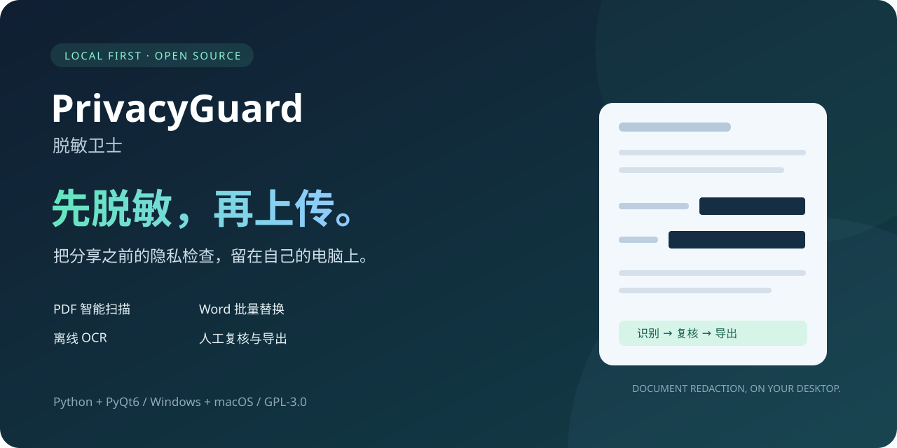
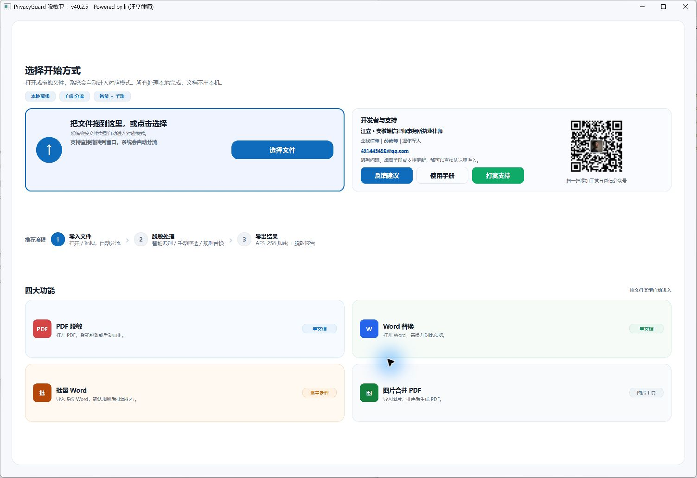
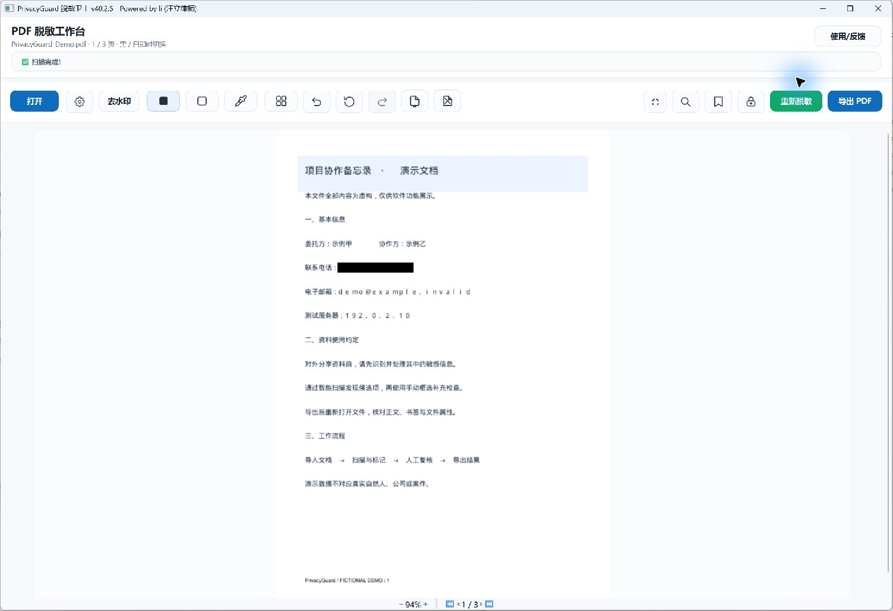
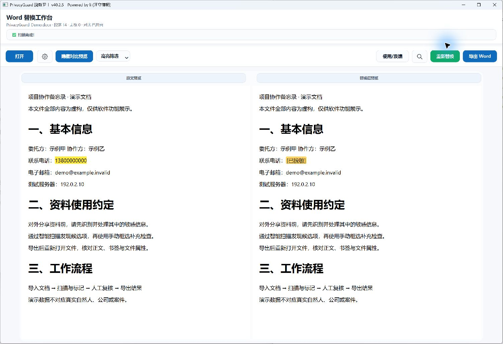

<div align="center">



# PrivacyGuard · 脱敏卫士

**先脱敏，再上传。让 PDF / Word 的隐私处理在本机完成。**

一个由中国基层律师从真实文书工作需求出发、借助 AI 持续开发的开源桌面工具。

[](https://github.com/lizilaywer/PrivacyGuard/actions/workflows/ci.yml)
[](CHANGELOG.md)
[](LICENSE)
[](#下载与运行)
[](https://github.com/lizilaywer/PrivacyGuard/stargazers)

[下载与运行](#下载与运行) · [功能一览](#功能一览) · [使用手册](user-guides/用户使用手册.md) · [English](README_EN.md) · [反馈问题](https://github.com/lizilaywer/PrivacyGuard/issues)

</div>

## 为什么做脱敏卫士

律师在整理卷宗、分享裁判文书、准备培训材料，或使用 AI 辅助工作时，经常需要先处理姓名、手机号、证件号和账户等信息。逐页查找费时，扫描件又不能直接搜索。

PrivacyGuard 把**智能扫描、手动补充、预览检查和导出**放进同一个本地工作台，帮助你在资料分享之前完成必要的隐私处理。核心文档处理不需要云端模型或 API Key；OCR 使用本地模型。安装依赖、下载软件以及主动打开反馈或在线手册仍需要网络。

它来自实际工作中的需要，也欢迎更多使用者带着匿名样本、问题和改进一起参与。

## 看看实际界面

以下为 **v40.2.5 Windows 源码运行实拍**，文档由脚本生成，内容全部虚构。页面遮罩属于编辑预览，实际脱敏结果以导出并复核的文件为准。

### 一个入口，四种工作方式



### PDF：扫描发现候选项，人工检查后导出



### Word：原文与替换结果并排检查



[观看两分钟操作快闪（B站）](https://www.bilibili.com/video/BV1NPDYB4EP1)

## 功能一览

| 工作场景 | 已实现的能力 |
| --- | --- |
| PDF 智能扫描 | 文字层搜索、扫描页 OCR、混合页文字层与图像块处理；证件、手机、邮箱、银行卡等内置规则，部分规则含校验位复核 |
| 手动精确处理 | 框选遮罩、黑白及自定义颜色、关键词全文定向遮罩、撤销与重做 |
| 法律文书辅助 | 称谓锚定的人名与部分机构名规则、名称跨页传播；印章和签名手印候选检测，需人工复核 |
| PDF 页面编排 | 多页网格、旋转、插页、删页、纵向区域提取与截去、书签浏览与编辑 |
| PDF 导出 | 对选中区域执行内容移除及图像像素处理；可选 AES-256 打开/编辑密码、脱敏统计报告 |
| Word 替换 | 正文与顶层表格、页眉页脚及首页/偶数页变体；精确词与正则规则、手动标记、双栏预览 |
| Word 批处理 | 同一套替换规则处理多份文件，逐文件与逐规则统计，错误可跳过或停止 |
| 配套工具 | 图片排序合并 PDF、全文搜索、会话草稿恢复、临时文件及痕迹清理 |

> 称谓人名规则默认关闭，按需启用；规则识别和 OCR 都可能误判或漏判。全文搜索对混合页图像内容的覆盖与智能脱敏管线不同，不能把“搜索不到”当作“没有敏感信息”。

## 下载与运行

### 直接使用

前往 **[GitHub Releases](https://github.com/lizilaywer/PrivacyGuard/releases)**，按发布说明选择平台和版本。源码版本与已上传便携包可能不同，请核对发布页中的版本、架构、校验值和已知问题。

- **Windows**：使用对应发布页提供的已验证便携包。历史 **v40.2.3 Windows 包不可分发**，请勿使用或转发。
- **macOS**：v40.2.5 便携构建目标为 Apple Silicon / macOS 14+，非 Intel / Universal2。构建采用 ad-hoc 签名，未做 Apple 公证；实际可下载资产以 Releases 为准。
- 本轮更新发布源码与展示素材，不新增二进制发行包，也不把源码 BuildKit 当作可直接运行的软件。

### 从源码运行（Python 3.11，64 位）

```powershell
# Windows / PowerShell
git clone https://github.com/lizilaywer/PrivacyGuard.git
cd PrivacyGuard
py -3.11 -m venv venv_win
.\venv_win\Scripts\python.exe -m pip install -r requirements.txt
.\venv_win\Scripts\python.exe main.py
```

```bash
# macOS
 git clone https://github.com/lizilaywer/PrivacyGuard.git
 cd PrivacyGuard
 python3.11 -m venv venv_macos_release
 ./venv_macos_release/bin/python3 -m pip install -r requirements.txt
 ./venv_macos_release/bin/python3 main.py
```

推荐优先使用 `.docx`；旧 `.doc` 依赖外部转换工具，转换能力与格式保留受本机环境影响。详细说明见 [Windows 构建指南](WINDOWS_BUILD_README.md) 与 [跨平台打包文档](docs/packaging/README.md)。

## 四步完成一次处理

1. **导入**：打开或拖入 PDF / Word；多份 Word 会进入批量入口。
2. **识别与标记**：选择需要的规则，运行智能扫描，用手动框选或关键词补充。
3. **复核**：逐页检查候选项，撤销误标，检查页眉页脚和书签。
4. **导出再检查**：另存为新文件，重新打开确认；PDF 可按需加密并导出报告。

**提取 PDF 的区域后，请“回炉打开”结果再做脱敏。原工作台的遮罩不会自动应用到提取结果。**

## 使用边界：对外分享前请读

这是辅助脱敏工具，不能保证任意文档自动达到匿名化要求。

- **Word**：超链接中的可见文字、嵌套表格、图片、文本框、批注、修订、脚注尾注及隐藏部件等，尚未得到统一完整处理；Word 图片不做 OCR 脱敏。导出 Word 不重新加密。
- **PDF**：选定区域的内容移除不等于全文件净化。元数据、附件、表单值和动作等仍需另行检查。
- **本机残留**：恢复草稿、结构快照和解密临时文件可能含原文，采用权限限制但不是加密存储；处理完成后可使用痕迹清理。
- **规则与性能**：称谓算法不是通用 NER；用户正则无执行超时，避免导入未经检查的复杂规则。

完整证据、优先级和后续方向见 [本轮仓库审查](docs/current/REPOSITORY_AUDIT_20261102.md) 和 [发布安全审计](docs/current/RELEASE_AUDIT_20261024.md)。

## 给开发者

采用 **Python + PyQt6 + PyMuPDF + RapidOCR + python-docx**。桌面协调器位于 `main.py`；OCR、后台任务、面板和纯逻辑分别放在 `privacyguard/` 的独立模块中。版本唯一来源为 `version.txt`。

```powershell
.\venv_win\Scripts\python.exe -m pip install -r requirements-dev.txt
.\venv_win\Scripts\python.exe -m ruff check main.py privacyguard tests
powershell -ExecutionPolicy Bypass -File scripts/run_regression.ps1
.\venv_win\Scripts\python.exe main.py --self-test
```

2026-11-02 Windows 本机验证：**741 项发现，738 通过，3 跳过**；代码规范、依赖一致性与原生离线自检通过。跳过项与验证范围见审查报告；这不是识别准确率指标。macOS 结果见对应发布审计。

[贡献指南](CONTRIBUTING.md) · [架构](ARCHITECTURE.md) · [开发约定](AGENTS.md) · [更新日志](CHANGELOG.md) · [安全反馈](SECURITY.md)

## 一起让它更好用

- 如果它帮助你少做了一次重复劳动，欢迎 **Star**，让更多有相同需求的人发现它。
- 反馈时请提供平台、软件版本、操作步骤和**虚构或充分匿名化的最小样本**，不要在公开 Issue 上传真实卷宗、密码或私人规则。
- 欢迎完善 Word 特殊内容处理、PDF 净化、跨平台验证、文档和匿名测试样本。

开发者：**汪立律师**。微信公众号：**池州汪律的AI进化论**；抖音：**池州有个汪律师**。

<details>
<summary>关注开发者，交流 AI 与法律实务</summary>


</details>

基于 [GNU GPL v3](LICENSE) 开源。分发与修改请遵守许可证。
