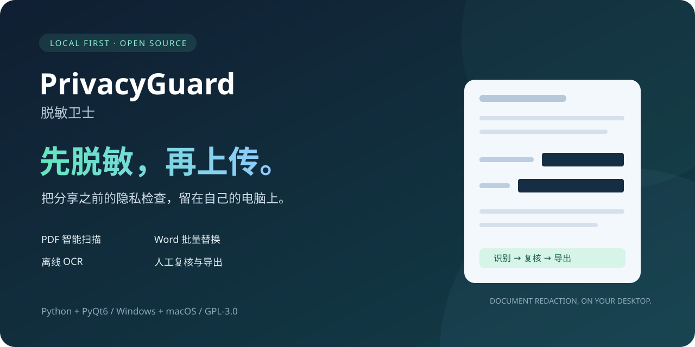
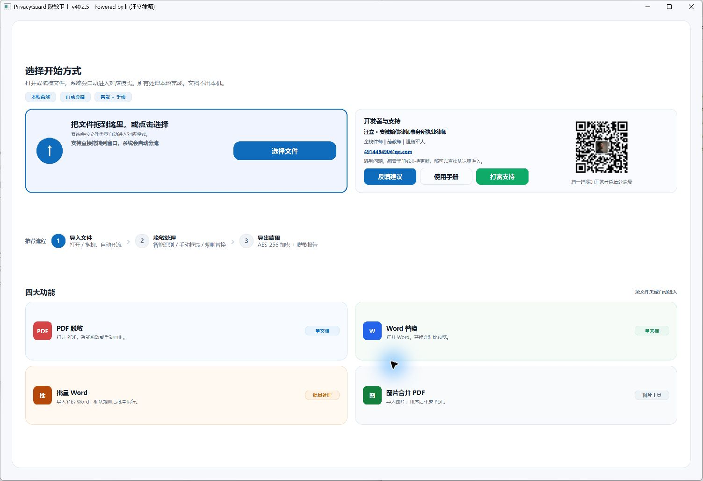
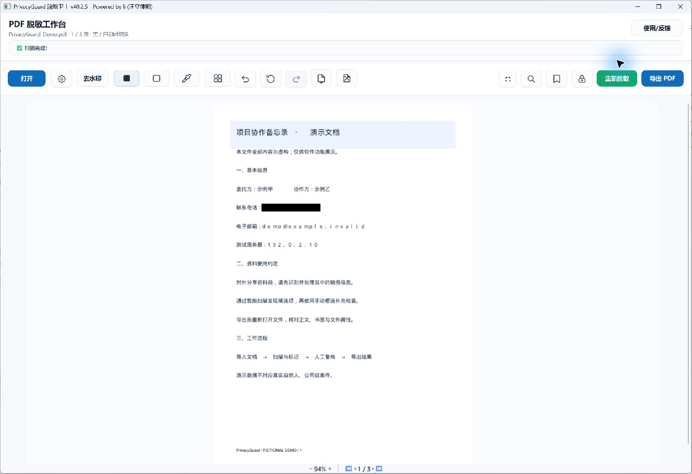
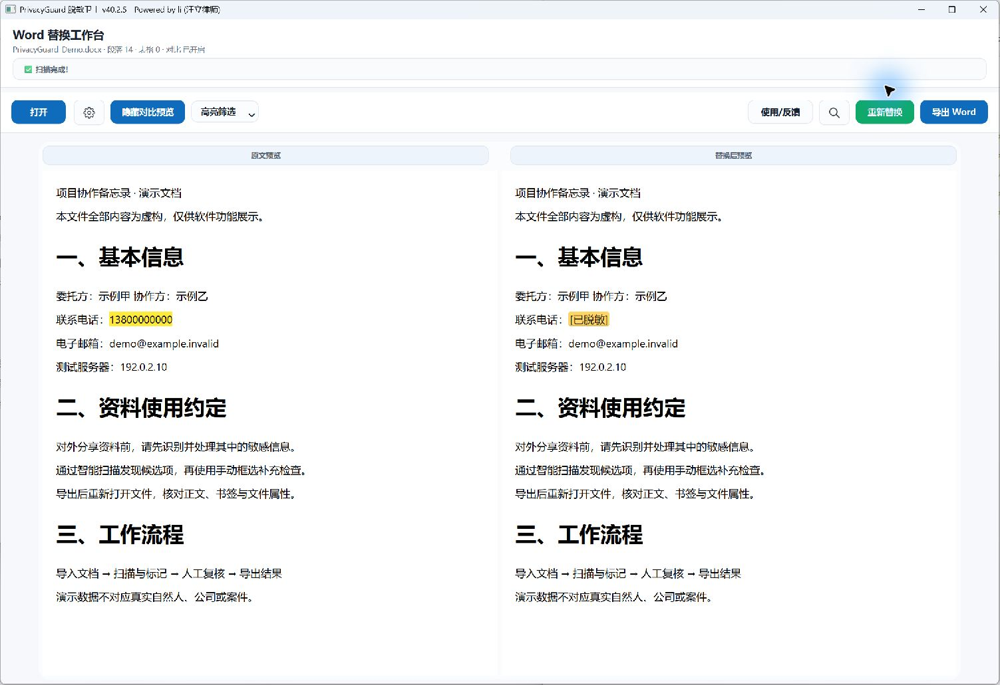

<div align="center">



# PrivacyGuard

**Redact before you share. PDF and Word processing on your own desktop.**

Built by a practicing lawyer in China, with AI assistance, for everyday document workflows.

[](https://github.com/lizilaywer/PrivacyGuard/actions/workflows/ci.yml)
[](CHANGELOG.md)
[](LICENSE)

[中文](README.md) · [Downloads](https://github.com/lizilaywer/PrivacyGuard/releases) · [Report an issue](https://github.com/lizilaywer/PrivacyGuard/issues) · [Contribute](CONTRIBUTING.md)

</div>

## Why it exists

Sharing case materials, preparing training documents, and using AI assistance often starts with removing personal information. PrivacyGuard combines automatic candidate detection, manual marking, review, and export in a desktop application. Core document processing uses local models and requires no cloud API key. Dependency installation, downloads, and user-triggered online feedback/help still use the network.

## See it in action

Screenshots show v40.2.5 running from source on Windows with entirely fictional documents. On-screen masks are editing previews; export and inspect the resulting file before sharing.



| PDF scanning and manual review | Word comparison preview |
| --- | --- |
|  |  |

[Watch the short demo on Bilibili](https://www.bilibili.com/video/BV1NPDYB4EP1)

## Features

- **PDF redaction:** text-layer matching, scanned-page OCR, mixed-page image blocks, custom keywords, manual masks, colors, undo/redo, and export reports.
- **Rules:** phone numbers, identifiers, email addresses, bank cards, and other patterns; selected identifiers receive checksum validation. Chinese title-anchored name rules are optional and disabled by default. Seal/signature-fingerprint candidate detection needs review.
- **PDF organization:** page grids, rotation, insertion/deletion, vertical extraction/cropping, bookmarks and bookmark-title replacement.
- **PDF protection:** password-protected input and optional AES-256 open/edit passwords on export.
- **Word:** exact/regex replacement, manual marking, side-by-side preview, top-level tables, and header/footer variants. Batch mode applies one shared rule set to multiple files.
- **Utilities:** images to PDF, document search, recovery drafts, and trace cleanup.

## Get started

Visit [Releases](https://github.com/lizilaywer/PrivacyGuard/releases) and read the platform, architecture, checksums, and known issues for each artifact. Source and published binaries may have different versions. **The historical v40.2.3 Windows artifact must not be distributed.**

The v40.2.5 macOS portable build targets Apple Silicon / macOS 14+, uses ad-hoc signing, and is not notarized. It is not an Intel or Universal2 build. Download availability is determined by the release assets. This repository update publishes source and showcase materials, not new binaries.

### Run from source (64-bit Python 3.11)

```powershell
# Windows / PowerShell
git clone https://github.com/lizilaywer/PrivacyGuard.git
cd PrivacyGuard
py -3.11 -m venv venv_win
.\venv_win\Scripts\python.exe -m pip install -r requirements.txt
.\venv_win\Scripts\python.exe main.py
```

```bash
# macOS
python3.11 -m venv venv_macos_release
./venv_macos_release/bin/python3 -m pip install -r requirements.txt
./venv_macos_release/bin/python3 main.py
```

Prefer `.docx`. Legacy `.doc` requires external conversion tools, with environment-dependent formatting. See [packaging documentation](docs/packaging/README.md).

## Review before sharing

1. Open a document and select the rules relevant to your task.
2. Scan for candidates and add manual markings.
3. Review every page, headers/footers, and bookmarks.
4. Export a new file, reopen it, and inspect the result.

PDF extraction does **not** automatically apply the source workbench masks. Reopen extracted results and redact them separately.

## Known limitations

- Word hyperlink text, nested tables, images, text boxes, comments, revisions, footnotes/endnotes, and hidden parts are not comprehensively covered. Word images are not OCR-redacted. Word export does not re-encrypt the document.
- PDF region redaction is not complete file sanitization: metadata, embedded attachments, form values, and actions need separate checks.
- Search can miss image text on mixed pages. Search results are not evidence that a file contains no sensitive information.
- Recovery snapshots and decrypted temporary files can contain original content. They are permission-restricted, not encrypted.
- OCR and rule detection can miss or incorrectly mark content. Chinese name rules are not general-purpose NER. User regex patterns have no execution timeout.

See the [repository review](docs/current/REPOSITORY_AUDIT_20261102.md) and [release audit](docs/current/RELEASE_AUDIT_20261024.md) for evidence and priorities. This is an assisted redaction tool, not a guarantee of anonymization.

## Development and contribution

Python, PyQt6, PyMuPDF, RapidOCR, and python-docx. Independent modules own OCR, workers, panels, and document logic; `main.py` coordinates the UI. `version.txt` is the version source.

```powershell
.\venv_win\Scripts\python.exe -m pip install -r requirements-dev.txt
.\venv_win\Scripts\python.exe -m ruff check main.py privacyguard tests
powershell -ExecutionPolicy Bypass -File scripts/run_regression.ps1
.\venv_win\Scripts\python.exe main.py --self-test
```

Verified on Windows, 2026-11-02: **741 discovered, 738 passed, 3 skipped**; lint, dependency consistency, and native offline smoke checks passed. These counts do not measure detection accuracy. See the review for scope and skip reasons.

Contributions to Word XML coverage, PDF sanitization, platform testing, docs, and synthetic fixtures are welcome. Please never attach private documents or passwords to public issues. Read [CONTRIBUTING](CONTRIBUTING.md) and [SECURITY](SECURITY.md).

If PrivacyGuard helps your workflow, a **Star** helps others find it.

Licensed under [GNU GPL v3](LICENSE).
