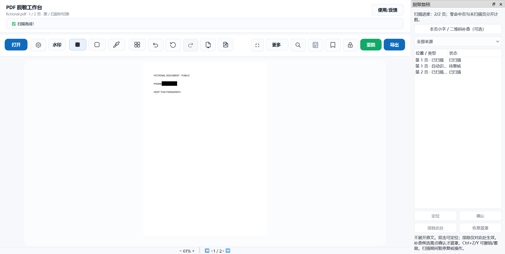
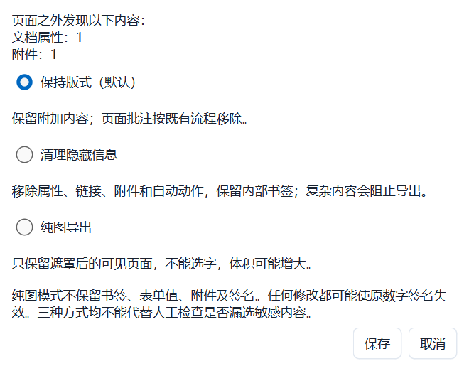
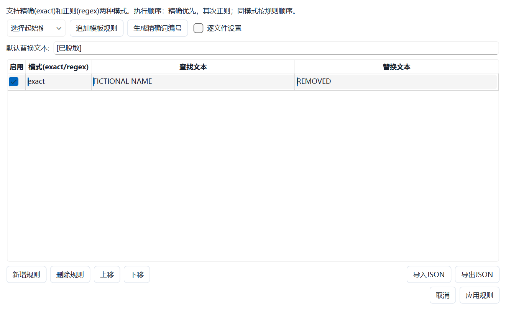

# v40.3：常用操作不变，复查更清楚

日常仍按 **打开 → 智能脱敏 → 看一遍 → 导出** 使用。新增功能按需打开，不要求逐项点击确认才能导出。

## 1. 想检查某一处：打开“复核”

工具栏上“搜索”旁的清单图标可打开/收起复核栏。双击一项会定位；清单默认不展开原文。

| 操作 | 实际意思 |
| --- | --- |
| 定位 | 跳到对应页或 Word 内容块 |
| 确认 | 保留已有遮罩，并记录您已检查；补查候选则在此时添加遮罩 |
| 排除此处 | 只去掉这一处自动识别遮罩，不影响其他同名/同号位置；不会自动撤销手工遮罩 |
| 恢复遮罩 | 撤回此前排除。Word 重开后尚未扫描的情况，需要再次扫描取回候选 |
| Ctrl+Z / Ctrl+Y | 撤销/重做；PDF 继续使用原有历史与草稿，Word 复核判断按文件内容指纹恢复 |

例如：同一个“13800138000”出现两次，您排除第一处，第二处仍被处理。不能用一次排除放过整篇所有相同号码。明确替换规则与自动识别冲突时，会提示先调整规则。

“已扫描，零命中”表示这一页经过扫描，但没有命中启用规则；**不是人工已确认，也不是零敏感信息证明**。未扫描/取消/失败仍需补查。页面内容或位置变化后，旧排除不会自动用于新的位置。

## 2. 导出 PDF：通常直接保存，有附加内容再选择

只含一般文档属性时，普通保存不多增加一步。发现附件、链接、表单等时会显示内容种类和数量；也可在保存窗口的文件类型中选“PDF 更多导出方式”。

| 方式 | 适合什么情况 | 会发生什么 |
| --- | --- | --- |
| 保持版式（默认） | 需要保留选字、书签等原有用途 | 移除已选区域内容；附加信息保持，页面批注沿用原有移除流程 |
| 清理隐藏信息 | 还要去掉属性、链接、附件和自动动作 | 只处理已支持的类型；遇到表单、隐藏文字、图层、结构或签名等复杂内容会停止，不报假成功 |
| 纯图导出 | 只需要最终可见页面，愿意放弃选字功能 | 从已经应用遮罩的页面像素新建 PDF，不复制原文档对象；不带原文字层、书签、附件和表单值，体积可能增大 |

三种方式都先写临时结果、重开检查，再保存到目标文件。不能覆盖输入原文档；失败时保留已有目标文件。数字签名在修改后可能失效，不宣称保留其验证有效性。

纯图输出仍可能含您未选中的可见敏感信息。它是对象重建方式，不是额外的自动识别保证。

## 3. Word：新增的内容会一同扫描和替换

正文、嵌套表格、超链接可见文字/目标、页眉页脚、脚注尾注、文本框、批注、修订/隐藏/字段文字及部分属性使用同一份内容清单。一般预览未展示的内容在“附加内容与隐藏文字”中补充显示。

替换尽量只改文字节点，保留原有段落、run 样式、表格和图片。不会盲目接受/拒绝所有修订；字段或外部数据刷新仍需用户按实际文件复核。未覆盖的嵌入对象、数据绑定、外部资源等会提示；**Word 图片像素不会自动 OCR 脱敏，导出不重新加密。**

## 4. 规则模板与批量：默认仍全部用同一套规则

- “追加模板规则”：卷宗/合同/流水/人事是起始配置，主要提供手机号/证件号规则。它不会猜出所有姓名、地址和账户，请补充实际需要的精确词。
- “生成精确词编号”：例如将明确输入的“张三、李四”变为“当事人1、当事人2”，生成后在表格中直接检查和修改。相同词是否同一人由您判断，不自动关联简称或同名人物。
- “逐文件设置”：只在需要时勾选。每行可用当前规则、起始模板、独立调整后的规则或跳过。选定的规则**替代**该文件的通用规则，不会偷偷沿用上一文件。
- 导入/导出 JSON 模板沿用原有入口，支持旧版本模板迁移，拒绝未知版本和超限内容。模板可能含原词，需妥善保管；不会自动上传。

例如：A 合同需把甲方改为“公司A”，B 合同需改为“公司B”，可在逐文件清单分别点“调整规则”，检查后开始。未单独指定的文件使用当前通用规则。

Word 规则的正则在独立小进程执行，超时会停止当前操作，不能把不完整替换当作成功。批量的逐文件/编号映射不写入结果报告，也不生成还原字典。

## 5. 小字、二维码、全半角号码：可选补查

- PDF 复核栏中的“本页小字 / 二维码补查”使用同一套本地 OCR 模型放大当前页，设像素、候选数量及时间预算；完成前可取消。只返回候选，选中并确认才加遮罩。
- 二维码只检测图案，不解码、不保存载荷、不访问里面的网址；其他条码尚不作为已支持能力。
- 搜索中的“补充匹配”可把 `１３８ ００１３-８０００` 作为 `13800138000` 的候选，并保留原文位置；不会自动改内容。
- 混合 PDF 搜索现在同时查看文字层和图片块；搜索失败不会显示为成功零命中。

默认 OCR 模型、版本和原定位算法保持不变。新字符定位候选未达到不退步门槛；3.10.0 对照未证明识别收益，均没有强行替换。

详细验证和便携包实际状态见 [升级验收记录](../docs/current/UPGRADE_COMPLETION_20261119.md)。
